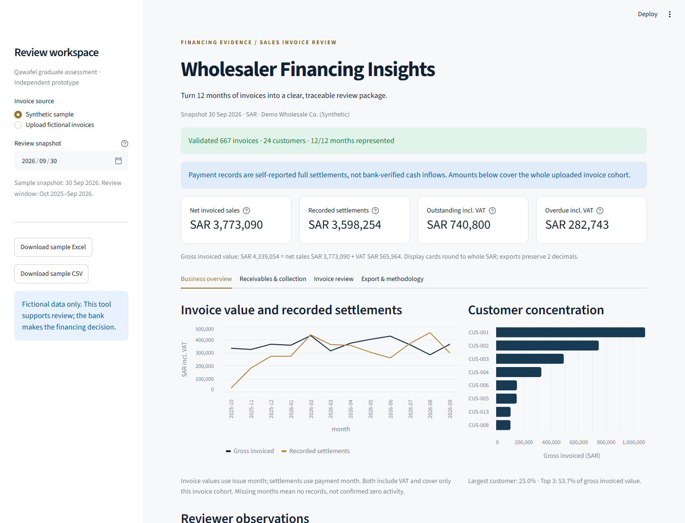

# Wholesaler Financing Insights

A focused Qawafel Graduate Software Engineer assessment prototype. It turns 12 months of fictional wholesale **sales** invoices into traceable evidence for a financing reviewer. The bank retains the lending decision.



## Start here

- [Written assessment answers](docs/assessment_answers.md) - Tasks 1, 2, 4, and the optional automation bonus, plus the prototype approach.
- [Submission PDF](output/pdf/qawafel-assessment.pdf) - the same written work, including a process diagram.
- [Production process and entity diagrams](docs/architecture.md).
- [Sample Excel](data/synthetic_invoices.xlsx) / [sample CSV](data/synthetic_invoices.csv) / [dataset manifest](data/manifest.json).
- [Assumptions](docs/assumptions.md), [AI disclosure](docs/ai_usage.md), and [technical walkthrough](docs/interview_walkthrough.md).

## Run locally

Use **Python 3.12**. No API keys, bank credentials, database, or external financial-data service are required.

```bash
python -m venv .venv
```

Activate on Windows PowerShell:

```powershell
.\.venv\Scripts\Activate.ps1
```

On macOS/Linux:

```bash
source .venv/bin/activate
```

Then:

```bash
python -m pip install -r requirements.txt
python -m streamlit run app.py
```

Open the local URL printed by Streamlit, normally `http://localhost:8501`. The synthetic sample loads by default. On PowerShell, activation is optional: use `.\.venv\Scripts\python.exe` instead of `python` if script execution policy blocks activation.

## What works

- Reads UTF-8 CSV and the first sheet of XLSX files; 5 MB / 10,000-row demo limit.
- Blocks analysis for duplicate invoice IDs, missing fields, invalid dates, inconsistent amounts, unsupported currencies, and explicitly unsupported payment/status fields. Reports row-level errors rather than silently dropping rows.
- Shows all 12 review months and warns about missing months.
- Computes net invoiced sales, VAT, gross invoice value, recorded full settlements, outstanding balances, overdue balances, aging, collection indicators, and customer concentration.
- Uses Isolation Forest to prioritize unusual invoices for human inspection. Scores are not fraud probabilities or credit decisions.
- Supports invoice table filters and downloads a reviewer summary, monthly metrics, validated invoice evidence, and the AI review queue.
- Processes uploads in server memory without writing them to disk. Production security and private-data ingestion are outside this demonstration; use fictional data only.

## Data and financial definitions

The sample contains **667 invoices for 24 explicitly synthetic retailers**, covering **1 October 2025-30 September 2026**. Snapshot: **30 September 2026**. Python seed: **42**. Monthly activity, customer sizes, payment terms, and delays vary; two deliberately unusual valid invoices illustrate review cases.

Money is summed as integer halalas. `net_amount_sar` is before VAT, `vat_amount_sar` is separate, and `invoice_amount_sar` is the gross value. The sample assumes an illustrative 15% VAT; it is not a tax-compliance implementation.

| Indicator | Meaning |
| --- | --- |
| Net invoiced sales | Sum of net amounts, excluding VAT; not profit or collected cash. |
| Recorded settlements | Gross value of fully paid invoices recorded by the snapshot; **not bank verified**. |
| Outstanding | Gross invoiced minus recorded settlements, including invoices still within terms. |
| Overdue | Unpaid gross value with due date strictly before snapshot; a subset of outstanding. |
| Settled share of due value | Settled gross value / total gross value among invoices due on/before snapshot. |
| On-time among paid | Count settled by due date / count of settled invoices; unpaid invoices excluded. |
| Customer concentration | Customer's gross invoice value / total gross value. |

The monthly settlement chart is a cohort view: payments on the included sales invoices, grouped by payment date. It excludes opening receivables and is not a complete business cashflow statement. Missing months are not proof of zero activity. Display cards round to whole SAR; exports retain two decimals.

For the sample, gross invoiced value is SAR **4,339,054.12**, net sales SAR **3,773,090.39**, recorded settlements SAR **3,598,254.47**, outstanding SAR **740,799.65**, and overdue SAR **282,743.33**. All values are generated, not observed business results.

## Upload schema

Required columns:

```text
invoice_id, customer_id, customer_name, invoice_date, due_date, payment_date,
net_amount_sar, vat_amount_sar, invoice_amount_sar, currency
```

Optional: `category`. Use the sample as a template. Dates use `YYYY-MM-DD` within 1900-2100; amounts use plain decimal notation with at most two decimals. A blank `payment_date` means unpaid; a nonblank date means the **entire** gross invoice amount was settled. Source rows start at 2, following the header. Invoice IDs must be unique; each customer ID maps to one name.

Invoices must fall within the selected snapshot month and preceding 11 months. Future payments are rejected instead of silently counted. Partial payments, existing status columns, and credit notes require a richer model. Selected unsupported fields are rejected; unfamiliar extra columns are identified as unused. Do not use this full-payment schema to represent partial settlements or adjustments.

## AI method and limits

The app fits a local Isolation Forest on gross amount, amount versus customer median, payment terms, and observed lateness. It uses 100 trees, seed 42, and an illustrative 5% contamination setting. This creates a small review queue; **5% is not a measured fraud/default rate** and is unrelated to the bank API's 3% status error scenario.

Higher scores mean more unusual relative to this cohort. Context hints describe record values, not causal feature explanations. Fewer than 30 invoices or fewer than three distinct profiles skips the model. There is no labeled credit/default dataset and no predictive-accuracy claim. The model does not alter financial totals. The reviewer summary is deterministic, not an LLM response. [Full AI disclosure](docs/ai_usage.md).

## Reproduce and test

```bash
python -m src.data_generation
python -m pip install -r requirements-dev.txt
python -m pytest -q
python tools/build_submission.py
```

The generator rewrites only its three sample output files. Tests cover reproducibility, validation failures, CSV/XLSX equivalence, hand-calculated metrics, aging boundaries, all-paid/all-unpaid cases, AI behavior, and Streamlit interactions. See [verification record](docs/verification.md) for executed results and remaining delivery checks.

## Design boundaries

Implemented: a single-process invoice analysis and review application. Proposed production APIs, document workers, database, identity/consent controls, PDF extraction, receipt reconciliation, and bank submission appear in the written design and **are not implemented services**.

The prototype cannot establish repayment affordability without bank-confirmed flows, costs, existing debt, and other lender-required information. It excludes partial payments, returns, credit notes, opening balances, and multiple currencies. Neither synthetic-data tests nor AI anomaly flags constitute validation for lending.

## Repository layout

```text
app.py                         Streamlit interface
src/data_generation.py         Reproducible fictional invoices
src/validation.py              Import contract and atomic checks
src/analysis.py                Deterministic financial calculations
src/anomalies.py               Unsupervised AI review queue
data/                          CSV, XLSX, and manifest
tests/                         Arithmetic, ingestion, AI, and UI checks
docs/                          Written answers, diagrams, assumptions, disclosure
tools/build_submission.py      Reproducible PDF export
output/pdf/                    Shareable written assessment
```

## Development attribution

OpenAI Codex assisted with implementation, documentation, synthetic data, company research, and checks. Earlier ChatGPT context supplied planning suggestions. The candidate should review and understand the submission before presenting it. No real bank integration or customer data is claimed. [Detailed disclosure](docs/ai_usage.md).
