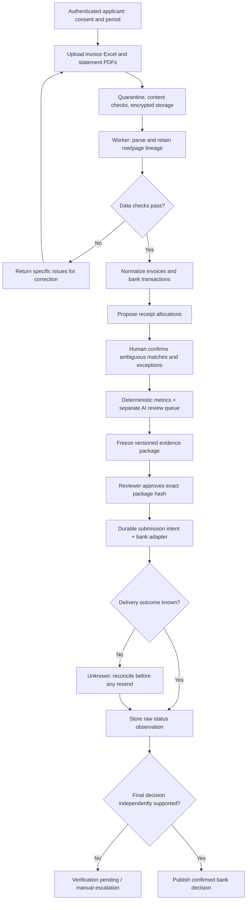
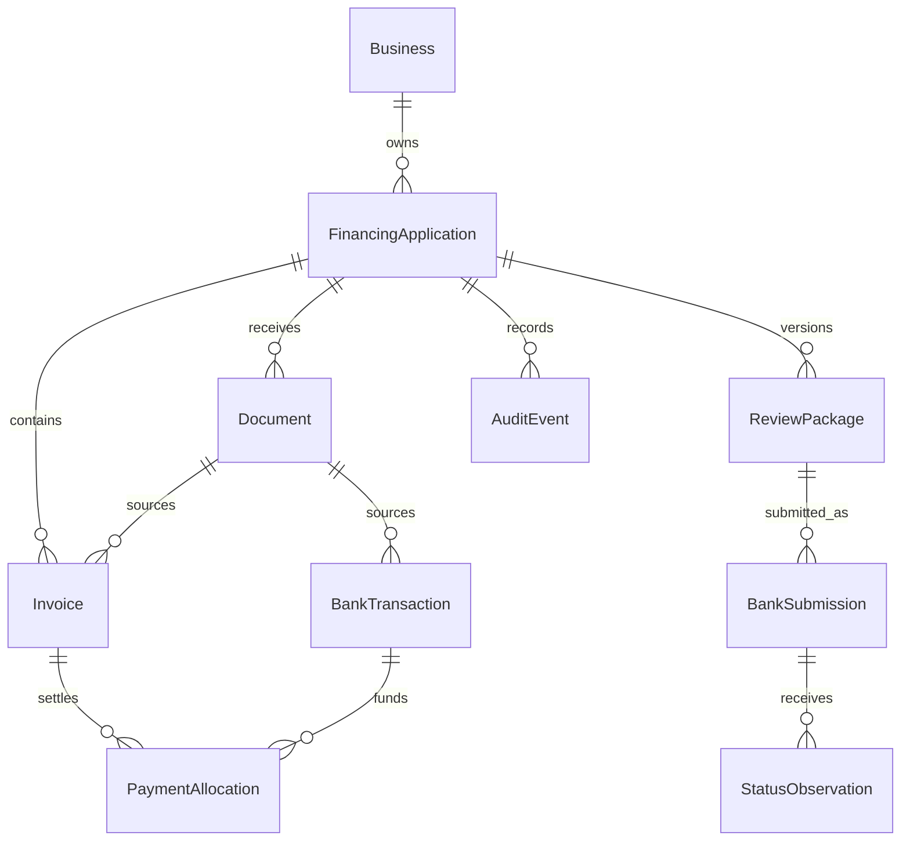

# Proposed production architecture

The Streamlit prototype implements invoice validation, analysis, anomaly review, and exports. All document workers, database entities, reconciliation, and bank services below are future production design.

## Process and trust boundaries

## Entity relationships

## Submission state rules

- Local transport: `queued -> sending -> acknowledged` or `unknown`. A definite pre-send failure can return to `queued`; a possibly delivered request cannot.
- Observed bank statuses are append-only; `last_observed_status` is distinct from `confirmed_status`.
- A final status requires agreed authoritative evidence. Contradictory observations create a verification task rather than overwriting a confirmed decision.
- Package changes invalidate approval and require a new version; they cannot mutate an in-flight submission.
- A bank-agreed reconciliation result may resolve an unknown outcome. A second identical API response is not independent evidence if the bank's error is systematic.
